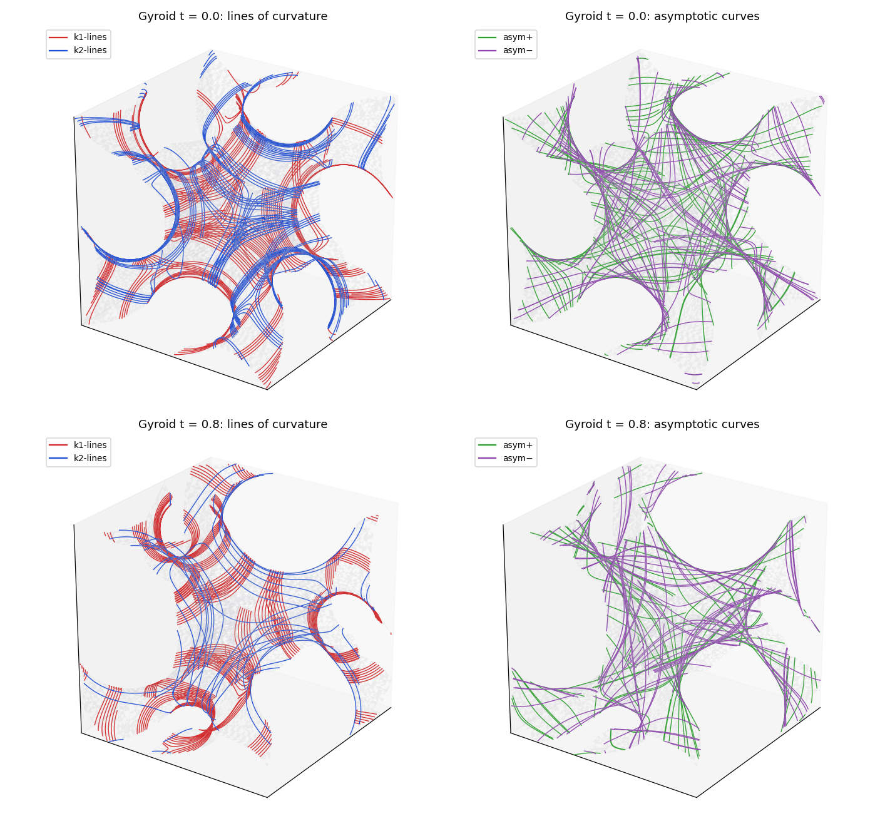

# TPMS 3D Curve Mapping

MATLAB tools for **3D curve mapping on triply periodic minimal surface (TPMS) lattices**. The tools trace and measure curve networks across the surface, computed directly from the analytic level-set equation rather than from meshed STL files. The detailed analysis (t-sweeps, wall thickness, electroplating) is built around the **gyroid**. A library run maps the core metrics, plus electroplating numbers, across **58 distinct TPMS and related level-set lattices** from the literature: 54 cubic plus 4 non-cubic (tetragonal and hexagonal) from an optional add-on. Every equation is checked so that no lattice is counted twice.



## What it does

Triply periodic minimal surfaces (TPMS) such as the gyroid are widely used in additively manufactured lattices. They are usually characterised point by point, using curvature values at each spot on a meshed surface. This project adds information that per-point curvature cannot provide: **how the surface curves are organised across the structure**.

It works from the surface's level-set equation. For the gyroid, the surface implemented so far, that is

```
sin x cos y + sin y cos z + sin z cos x = t
```

It traces two families of curves on the surface:

- **Lines of curvature** follow the directions of maximum and minimum bending.
- **Asymptotic curves** follow the directions along which the surface does not bend.

By default it reports a lean **core set of five curvature metrics**:

| Metric | What it tells you |
|---|---|
| Curvature-change length | How far along the surface the bending stays roughly the same (from the mean-curvature gradient) |
| Sideways turning radius | How sharply the lines of curvature steer within the surface, in mm |
| Straightness of max-bending lines | How far these curves get compared with how far they travel (0 to 1) |
| Straightness of min-bending lines | The same for the other family; together they show, for example, rings forming around struts |
| Handedness index | Whether twisting is balanced or biased left/right; point curvature can't see this |

It also reports what the level-set value t physically does to the part (wall thickness, solid fraction, S/V) and electroplating numbers (Wagner and inverse Damköhler).

About 25 further descriptors are still computed and saved, but left out of the core set. They include direction memory, loop shares, twist pitch, asymptotic-curve metrics and build-direction alignment. Set `cfg.descriptorSet = 'full'` to use all of them.

Each curve-based number comes with a 95% confidence interval, so it is clear how trustworthy it is.

## Example results

For a sheet gyroid with a 5 mm cell, as the level-set value t rises from 0 to 0.8 (walls thicken from 0 to 0.89 mm):

- Max-bending lines lose almost all straightness (0.44 → 0.05) as they wrap around the thickening struts.
- Min-bending lines go from never closing to 100% closed loops.
- The handedness index rises from 0.00 (balanced) to 0.17, revealing the gyroid's chirality.

The full output from this run is in [`examples/results/gyroid_summary.md`](examples/results/gyroid_summary.md). It includes the electroplating section, using the paper's placeholder bath values.

## Electroplating descriptors

From the lattice's porosity, wetted surface area and cell size, the tool computes lattice versions of two dimensionless numbers after Clemens et al., *ACS Appl. Eng. Mater.* 2025, 3(3), 600–612 ([doi:10.1021/acsaenm.4c00561](https://doi.org/10.1021/acsaenm.4c00561)):

- **Wagner number (Wa):** coating uniformity. High means the interior plates nearly as thick as the outside.
- **Inverse Damköhler number (Da⁻¹):** ion supply by flow versus consumption by plating. Low means depletion, rough deposits and dendrites.

From these it reports a maximum current density for a target uniformity and the electrolyte flow needed for a target Da⁻¹.

The equations are reconstructed from the paper's definitions, so absolute values may be off by a constant (about 1.5×). **Use them to rank designs, not as absolute predictions.** The geometry-only parts work without any bath data, and the process inputs (placeholders from the paper) are set in `cfg.plating`. The core function, `src/tpms_plating_numbers.m`, takes porosity, surface area and cell size, so it also works for strut or STL-based lattices.

## Mapping the TPMS library

`run_tpms_library.m` analyses every surface in `src/tpms_library.m` at the same cell size and ranks which lattices have the most extreme curvature metrics. The library has 56 entries, of which 54 are distinct lattices:

- **Classic TPMS:** Schwarz P and D, Gyroid, Neovius, I-WP, F-RD, Fischer–Koch S, Lidinoid, Split P, O,C-TO.
- **Further minimal surfaces:** complementary and Y-family surfaces, G′, D′, Karcher K, I2-Y**, Slotted P, Q* and others.
- **Non-minimal lattices:** double, tubular and "bionic bone" variants, and the S-series from Vasile et al. (2024).

**Sources.** The equations come from:

- the MATLAB files of the peer-reviewed catalog by Fisher et al. (*Data in Brief* 2023);
- Bernhard 2026 (arXiv:2604.07160);
- nTop;
- the MiniSurf source (Hsieh & Valdevit 2020);
- Schwarz & Gompper (arXiv:cond-mat/9903406);
- Gandy et al. 2001, Wohlgemuth et al. 2001 and Vasile et al. 2024.

Genus values come from Lord & Mackay (*Current Science* 2003).

**No lattice is counted twice.** `tpms_library_duplicates` tests every pair of equations for describing the same lattice: the same surface up to rotation, reflection, translation, scale or doubled frequency. It found that two existing entries (an alternative form of D and a second Double Diamond) were duplicates, which are now skipped. It also rejected four new candidates found during the literature search.

**Checks.** Every equation is tested before it is ranked: genus per primitive cell, closeness to a minimal surface, and smoothness.

- 13 of the 16 surfaces with a literature genus match it.
- Wherever the Fisher et al. catalog differs from the community-collected formulas, its version is the better approximation.
- The widely used nodal "Lidinoid" equation does not have the Lidinoid's topology (genus 17 per primitive cell instead of 3).

**Non-cubic add-on.** `src/tpms_library_noncubic.m` adds lattices whose repeating cell is not a cube: a hexagonal Lonsdaleite surface and tetragonal tP, tD and tG at c/a = 1.5. Their equations stay ordinary trig level sets; only the box changes, from 2π on every axis to a per-axis period.

- **Marking:** they are flagged in the `cell` column and starred (*) in the report and heatmap.
- **Switching off:** `cfg.includeNonCubic = false` gives the cubic-only run.
- **Baseline unchanged:** before and after this add-on, the gyroid pipeline outputs are byte-identical, and a five-lattice library run matches exactly on all 46 columns.

**Curvature** is compared at t = 0. **Electroplating** (lattice Wagner and inverse Damköhler numbers, Clemens et al. 2025) is compared at a matched solid fraction (default 16%), because at t = 0 a sheet has zero wall thickness.

Results ([`examples/tpms_library/tpms_library_report.md`](examples/tpms_library/tpms_library_report.md)):

- **Most extreme curvature:** Tubular Primitive, then the two Double Diamonds.
- **Most even coating / least flow needed:** Tubular Primitive and Tubular Gyroid. The least even are Complementary D and Complementary S.
- **Chirality:** single-handed structures are flagged by the handedness index. They include the Fischer–Koch Y and C(Y) surfaces and the one-channel gyroid variants.

## Quick start

1. Open `run_gyroid_curve_mapping.m` in MATLAB.
2. In the configuration block at the top, set `cfg.cellSize` (your cell size, default 5 mm) and `cfg.latticeType` (`'sheet'` or `'network'`). Optionally set `cfg.descriptorSet` (`'core'` or `'full'`).
3. Run it. Results are written to `results/gyroid_curve_results/`. Start with `gyroid_summary.md`.

Other entry points:

- `run_sampling_study.m` shows how the results depend on sampling settings and recommends values.
- `run_tpms_library.m` maps the core metrics across the whole TPMS library. It takes about 20 minutes in Octave, less in MATLAB, and can be stopped and resumed.
- `tpms_t_for_thickness(0.4, 5)` returns the level-set value t that gives 0.4 mm walls in a 5 mm cell. Run `addpath src` first if you haven't run a script in this session.

### Requirements

- MATLAB R2016b or later.
- The Symbolic Math Toolbox is optional. Without it, set `cfg.derivMethod = 'manual'`, which uses hand-derived derivatives with identical results.
- The code is also tested in GNU Octave 8.4 with the `symbolic` package; figure generation there is untested.

## Outputs

| File | Contents |
|---|---|
| `gyroid_summary.md` / `.csv` | Plain-language metrics per t, with meanings and 95% confidence intervals |
| `gyroid_t_vs_wall_thickness.csv` | t → wall thickness, solid fraction, surface-to-volume ratio |
| `gyroid_electroplating.csv` | t → Wagner and inverse Damköhler numbers, max current, required flow |
| `gyroid_curve_descriptors_PCA.csv` | The core descriptors (or all of them in `'full'` mode), one row per t, ready for PCA |
| `gyroid_curve_descriptors_long.csv` | Every descriptor, tagged by role (core, extended, redundant, reference, …) |
| `gyroid_curves_percurve.csv` | One row per traced curve |
| `*.png` | Curve networks, distributions, trends |

## Validation

The run starts with 27 self-checks. They include:

- symbolic vs hand-derived derivatives;
- closed-form vs eigen-solved curvature;
- analytic vs finite-difference geodesic curvature (second-order convergence confirmed);
- known differential-geometry identities;
- curves staying on the surface to about 1e-15;
- cubic and inversion symmetry of the gyroid;
- self-consistency of the electroplating formulas.

## Repository layout

```
run_gyroid_curve_mapping.m   main analysis
run_sampling_study.m         sampling sensitivity study
run_tpms_library.m           metrics across 58 TPMS lattices (54 cubic + 4 non-cubic)
src/                         all functions (tpms_*.m)
examples/                    outputs from a test run
docs/TECHNICAL.md            full method notes, conventions, limitations
```

## Documentation

[`docs/TECHNICAL.md`](docs/TECHNICAL.md) covers:

- the mathematics and sign conventions;
- which descriptors are genuinely new and which restate point curvature;
- the tortuosity normalisation;
- the wall-thickness method;
- the sampling-study results;
- known limitations.

## Status

This is a research tool. The 3D curve-mapping method works for any TPMS defined by a level-set equation. The full validation suite, t-sweeps, wall thickness and electroplating analysis are built for the **gyroid**. Other surfaces can be analysed at t = 0 through the library run, with per-surface checks (genus, minimality, smoothness, cubic symmetry). New surfaces are added as one line in `src/tpms_library.m`, or passed directly as `struct('key', ..., 'expr', ...)` to `tpms_build_fields`. File names such as `run_gyroid_curve_mapping.m` and `gyroid_summary.md` refer to the gyroid run specifically.

## Citation

If you use this in academic work, please cite it using [`CITATION.cff`](CITATION.cff). On GitHub, the "Cite this repository" button generates the citation for you.

## License

Copyright (C) 2026 YOUR NAME

This program is free software: you can redistribute it and/or modify it under the terms of the GNU General Public License as published by the Free Software Foundation, either version 3 of the License, or (at your option) any later version.

This program is distributed in the hope that it will be useful, but WITHOUT ANY WARRANTY; without even the implied warranty of MERCHANTABILITY or FITNESS FOR A PARTICULAR PURPOSE. See the [GNU General Public License](LICENSE) for more details.
